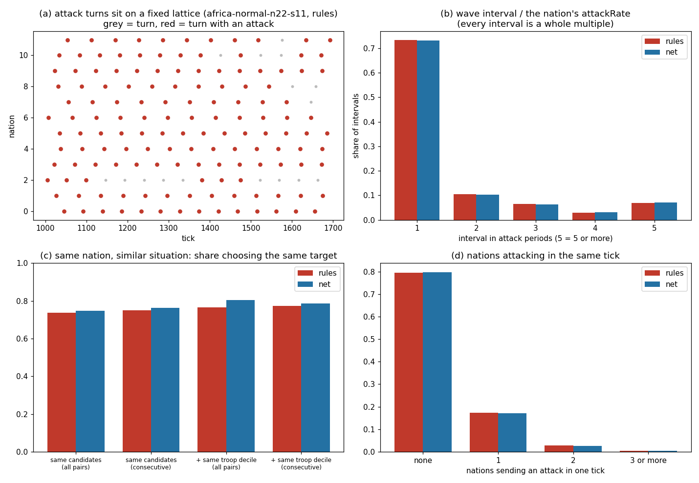

# Bot-feel baseline (Hard nations, 54 fresh seeds, 6000 ticks)

Compare any later change with this table (bot_baseline.json holds the numbers).

| measure | rules | network |
|---|---|---|
| attack turns on the nation's own phase | 1.0000 | 1.0000 |
| wave intervals that are whole multiples of attackRate | 1.0000 | 1.0000 |
| intervals of exactly 1 period | 0.733 | 0.732 |
| attackRate min / max / mean | [45, 59, 51.99936708860759] | [45, 59, 51.99936708860759] |
| same target, same candidate set (all pairs) | 0.737 | 0.747 |
| same target, same candidates (consecutive) | 0.751 | 0.762 |
| same target, + same troop decile (all pairs) | 0.765 | 0.804 |
| same target, + same troop decile (consecutive) | 0.774 | 0.786 |
| ticks with 0 / 1 / 2 / 3+ nations attacking | 0.795 / 0.173 / 0.028 / 0.005 | 0.798 / 0.171 / 0.027 / 0.004 |
| senders per tick: variance / mean (1 = Poisson) | 1.12 | 1.12 |
| most nations attacking in one tick | 7 | 7 |

