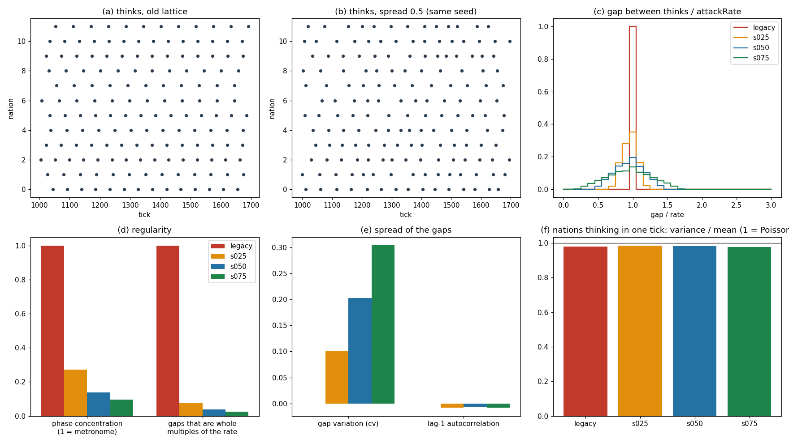

# Nation timing, phase A (jittered thinks), Hard nations, 54 fresh seeds

| config | phase concentration | gaps that are multiples of the rate | gap cv | lag-1 | mean gap / rate | var/mean per tick |
|---|---|---|---|---|---|---|
| legacy | 1.000 | 1.000 | 0.000 | nan | 1.0000 | 0.98 |
| s025 | 0.272 | 0.077 | 0.102 | -0.008 | 1.0001 | 0.99 |
| s050 | 0.138 | 0.039 | 0.203 | -0.007 | 1.0001 | 0.98 |
| s075 | 0.097 | 0.026 | 0.305 | -0.008 | 1.0002 | 0.98 |

